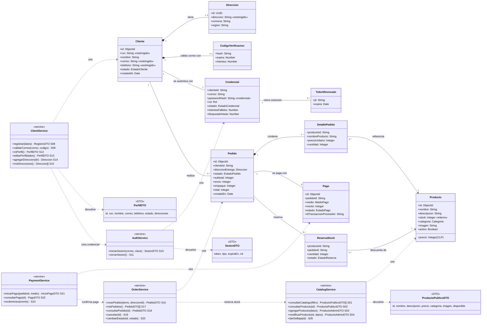

# Módulo 2 — Clases y cardinalidades del dominio

Diagrama en Mermaid (editable como texto; GitHub lo dibuja automáticamente).
Las entidades marcadas *(avance 9)* están diseñadas y se implementan en ese avance.

## 1. Diagrama de clases del dominio y servicios públicos

**Leyenda:** `*--` composición (la parte no existe sin el todo), `--` asociación, `-->` asociación navegable,
`..>` dependencia de uso (un servicio usa una clase o contrato; no es una relación entre registros).
«restringido» = dato personal; «credencial» = secreto del usuario; «interno» = no sale en respuestas públicas.

## 2. Relaciones y la regla que origina cada cardinalidad

| Origen | Destino | Multiplicidad | Tipo | Regla de negocio |
|---|---|---|---|---|
| Cliente | Direccion | 1 — 1..5 | composición | El registro exige una dirección (P02). El mockup indica "guarda múltiples comunas"; se limita a 5 para acotar datos personales. Si se borra el cliente, se borran sus direcciones. |
| Cliente | CodigoVerificacion | 1 — 0..1 | composición | Existe solo mientras la cuenta está pendiente; al validar el correo se elimina. |
| Cliente | Credencial | 1 — 1 | asociación entre sistemas | Cada cliente tiene exactamente una credencial en auth (mismo `clienteId`). El administrador es una credencial **sin** cliente. |
| Credencial | TokenRevocado | 1 — 0..* | asociación | Cada cierre de sesión revoca un token; el registro se borra solo cuando el token habría vencido. |
| Cliente | Pedido | 1 — 0..* | asociación | Un cliente puede no haber comprado nunca; cada pedido pertenece a un solo cliente. |
| Pedido | DetallePedido | 1 — 1..* | composición | Un pedido confirmado tiene al menos un ítem. **No existe pedido vacío**: el carrito vive en el navegador hasta confirmar. |
| DetallePedido | Producto | 0..* — 1 | asociación | Cada línea apunta a un producto, pero copia `nombreProducto` y `precioUnitario` al momento de comprar: si el producto cambia de precio o se da de baja, el historial no cambia. |
| Pedido | Pago | 1 — 0..* | asociación | Un pedido puede tener varios intentos de pago (uno rechazado y otro aprobado); como máximo uno queda aprobado. |
| Pedido | ReservaStock | 1 — 0..* | asociación | Se reserva stock por cada producto del pedido; la reserva se libera si el pago falla o el pedido se cancela. |

## 3. Decisiones del equipo

- **Carrito y pedido son distintos.** El carrito es estado del navegador (el usuario lo arma sin sesión). El
  pedido existe solo en el servidor y se crea al confirmar; el servidor recalcula precios y totales.
- **Historial con productos dados de baja.** La baja es lógica (`activo = false`) y además el detalle guarda una
  copia de nombre y precio, así un pedido antiguo se sigue viendo igual.
- **Modelo interno vs. DTO.** `stock`, `activo`, `passwordHash`, `codigoVerificacion` e `intentosFallidos` nunca
  salen en respuestas públicas. El catálogo expone `disponible` (calculado), no el stock exacto.
- **Fecha de nacimiento y sexo (P02) se eliminan del modelo.** El caso no los necesita para vender ni despachar;
  guardarlos solo aumentaría los datos personales a proteger (ver Módulo 7). El formulario se ajusta en el avance 11.

## 4. Correspondencia operación UML ↔ servicio

| Operación | ID | Estado |
|---|---|---|
| CatalogService.consultarCatalogo / consultarProducto / agregarProducto / modificarProducto / darDeBaja | S01–S05 | Implementado (inventory) |
| ClientService.registrar / validarCorreo | S08, S09 | Implementado (clients + auth) |
| AuthService.iniciarSesion / cerrarSesion | S10, S11 | Implementado (auth) |
| ClientService.miPerfil / editarPerfil / agregarDireccion / misDirecciones | S12–S15 | Implementado (clients) |
| OrderService.* | S16–S20 | Avance 9 |
| PaymentService.* | S21–S23 | Avance 9 |
