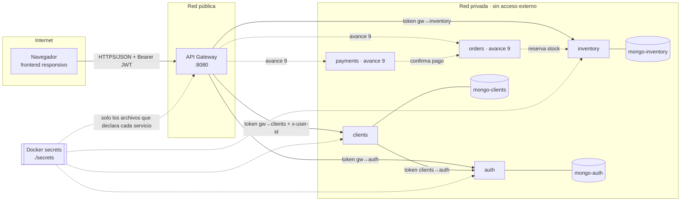
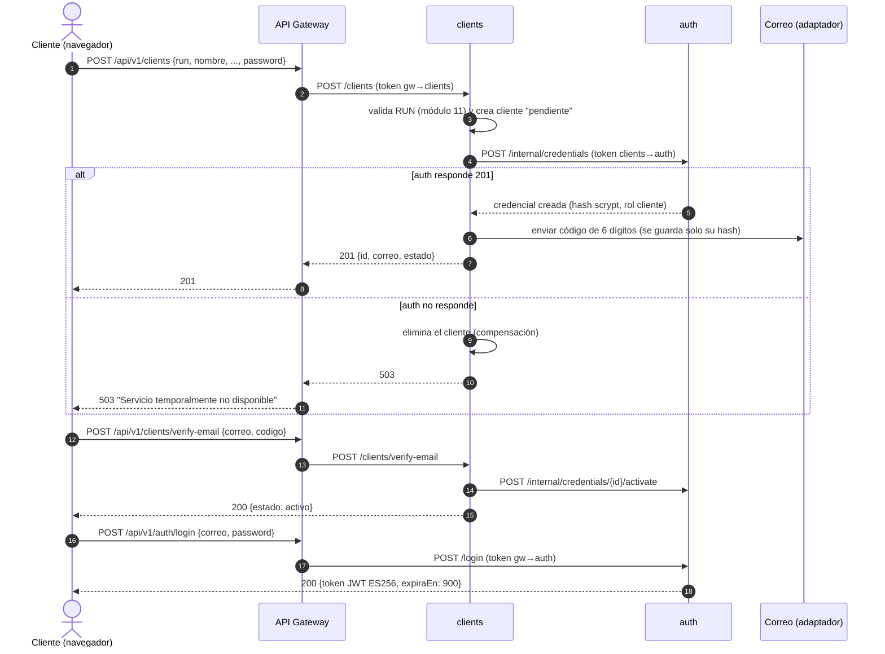

# Módulo 3 — Sistemas e integraciones

## 1. Matriz de sistemas

Cada sistema es un microservicio privado con su **propia base de datos**. Ningún servicio lee la base de otro:
colaboran solo por contratos HTTP en la red privada, autenticados con un token de servicio por cada par.

| Sistema | Responsabilidad | Datos que administra (autoridad) | Servicios | Dependencias | Contrato de integración | Credencial requerida | Respuesta ante fallos |
|---|---|---|---|---|---|---|---|
| **inventory** | Catálogo, disponibilidad y stock | Producto (precio oficial, stock, estado) | S01–S05; S06–S07 internos | — | REST interno `/products` | `svc_token_gateway_inventory` (gateway); en el avance 9 se suma uno para orders | Si cae: el catálogo responde 502 en el gateway; orders no acepta pedidos nuevos |
| **clients** | Registro, perfil y direcciones | Cliente, Direccion, CodigoVerificacion | S08, S09, S12–S15 | auth (crear y activar credencial) | REST interno `/clients/...` | `svc_token_gateway_clients`; usa `svc_token_clients_auth` hacia auth | Si auth no responde durante el registro, se deshace el cliente creado (compensación) y responde 503 |
| **auth** | Credenciales, sesiones y tokens | Credencial (hash, rol, estado), TokenRevocado | S10, S11, internos de credenciales y revocación | — | REST interno `/login`, `/logout`, `/internal/...` | `svc_token_gateway_auth`, `svc_token_clients_auth`; firma con `jwt_private_key` | Si cae: el gateway rechaza rutas protegidas con 503 (falla cerrado); el catálogo público sigue funcionando |
| **orders** *(avance 9)* | Creación y ciclo de vida del pedido | Pedido, DetallePedido (estado oficial del pedido) | S16–S20 | inventory (reservar stock) | REST interno `/orders` | token gateway→orders; token orders→inventory | Si inventory no responde: no confirma el pedido (no se arriesga a vender sin stock) |
| **payments** *(avance 9)* | Inicio de pago y verificación del aviso del proveedor | Pago (estado del pago) | S21–S23 | orders (marcar pagado), proveedor de pagos | REST interno `/payments`; aviso firmado del proveedor | token gateway→payments; clave del proveedor (solo payments) | Aviso duplicado: idempotente por id de transacción; aviso con firma inválida: 401 |
| **api-gateway** | Único punto público; autenticación, autorización, rutas | Ninguno (solo configuración) | Todas las rutas externas | inventory, clients, auth | Tabla de rutas `routes.js` | `jwt_public_key` y un token por cada destino | Servicio lento 504, caído 502, sin detalles internos |
| Correo *(externo)* | Enviar el código de verificación | — | S08 | — | Adaptador `mailer.js` | En local: adaptador de prueba sin credencial | Si falla el envío, el registro queda pendiente y el error se registra |
| Webpay / Servipag *(externo, avance 9)* | Cobro | Transacción en el proveedor | S21, S23 | — | Adaptador de prueba que preserva el contrato | Clave del comercio (solo payments) | Ver payments |

**Quién decide el estado oficial:** precio y stock → inventory; datos personales → clients; rol y validez de
la sesión → auth; estado del pedido → orders; estado del pago → payments (nunca el navegador).

## 2. Mapa de componentes

## 3. Secuencia representativa: registro y primer inicio de sesión (implementado)

## 4. Secuencia diseñada: pedido y pago (avance 9)

1. `POST /api/v1/orders` con `{items:[{productoId, cantidad}], direccionId}`. El navegador **no** envía precios.
2. orders pide a inventory reservar cada ítem (`POST /products/{id}/reservations`, idempotente por `pedidoId`).
   Si un ítem no tiene stock → 409 y se liberan las reservas ya hechas. Si inventory no responde → 503 sin pedido.
3. orders calcula subtotal con los precios de inventory, envío gratis dentro de 3 km y empaque $1.200; crea el pedido `pendiente_pago`.
4. `POST /api/v1/orders/{id}/payments` → payments crea el pago con el **monto que fija orders**, no el del navegador.
5. El proveedor avisa a `POST /api/v1/payments/webhook`; payments verifica la firma, ignora avisos repetidos
   (mismo id de transacción) y solo entonces pide a orders marcar el pedido como `pagado`.
