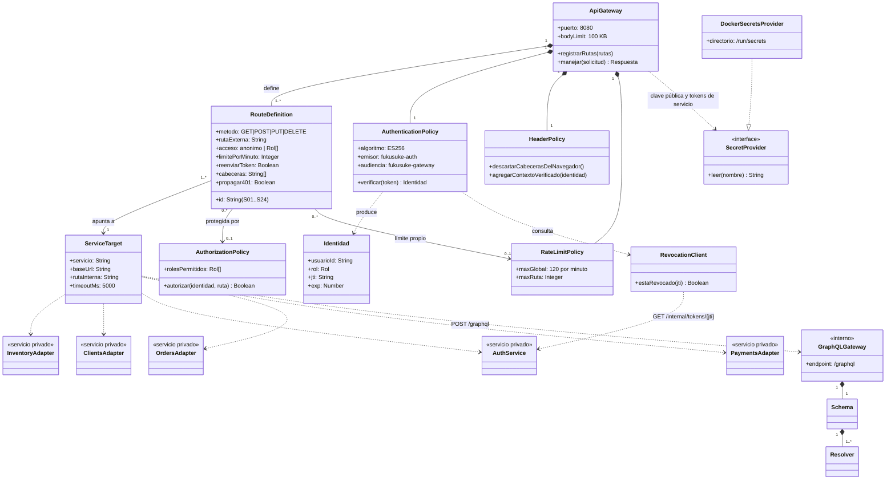

# Módulo 5 — Clases del API Gateway

## 1. Decisión: un solo API Gateway

Se usa **un** API Gateway externo. Todas las rutas comparten el mismo dominio, el mismo frontend y la misma forma
de autenticar; separarlas por políticas (anónimo, cliente, admin) dentro de un gateway basta. Un segundo gateway
externo agregaría otro componente público que proteger sin un beneficio concreto para este caso.
El **GraphQL Gateway** es un componente **interno** (servicio `graphql-gateway`), al que solo se llega pasando por el API Gateway (ruta S24). Ver Módulo 8.

## 2. Diagrama de clases del gateway y sus políticas

**Relaciones estructurales vs. comunicación:** las composiciones (`*--`) son partes del gateway en memoria. Las
dependencias (`..>`) hacia AuthService, inventory y clients son **llamadas de red** por la red privada, no
relaciones entre objetos. El mapa de componentes del Módulo 3 muestra esas redes; este UML no lo reemplaza.

Las políticas de autorización se **comparten** entre rutas: todas las rutas `['admin']` usan la misma política
(por eso `0..*` hacia `0..1`). Las rutas anónimas no tienen política de autorización.

## 3. Qué valida el gateway y qué valida cada sistema

| Control | API Gateway | Servicio interno |
|---|---|---|
| Verbo + ruta permitidos (lista blanca) | ✔ (404 si no existe) | ✔ (sus propias rutas) |
| Token JWT: firma, algoritmo, emisor, audiencia, vencimiento | ✔ | — |
| Sesión revocada | ✔ (consulta a auth; si auth no responde → 503) | — |
| Rol por ruta | ✔ | ✔ otra vez en cada servicio (defensa en profundidad) |
| Llamada proviene del gateway | — | ✔ `x-service-token` (401 si falta) |
| Propiedad del recurso (`/me`, pedidos y pagos propios) | — | ✔ (clients, orders, payments, graphql-gateway) |
| Validación de datos de negocio (RUN, precio, stock…) | — | ✔ |
| Límite de solicitudes y tamaño de cuerpo | ✔ | — |
| Cabeceras del navegador que pasan (`Idempotency-Key`, firma del proveedor) | ✔ lista blanca por ruta | ✔ validan formato |
| Firma del aviso de pago (HMAC) | — (ruta anónima) | ✔ payments |
| Profundidad, costo y campos GraphQL | — | ✔ graphql-gateway |
| Tiempo de espera hacia el servicio | ✔ (504) | — |
| Mensajes de error sin detalles internos | ✔ | ✔ |

## 4. Fronteras de confianza

1. **Navegador → Gateway (no confiable).** Todo lo que llega del navegador se valida: cabeceras, token, cuerpo.
   Las cabeceras `x-user-id`, `x-user-role` y `x-service-token` que envíe el navegador se descartan.
2. **Gateway → servicios (red privada).** Los servicios confían en `x-user-id` **solo** si la llamada trae el
   token de servicio del gateway. La red privada es `internal` y no publica puertos.
3. **Servicio → servicio** (clients → auth). Token propio para ese par; auth acepta a clients solo en las
   rutas de credenciales.
4. **Servicio → base de datos.** Cada servicio usa un usuario de Mongo con permisos solo sobre su base.

## 5. Recorridos

**Solicitud autorizada** — un administrador crea un producto:
`POST /api/v1/products` con `Authorization: Bearer <jwt>` → límite de solicitudes OK → ruta S03 existe →
firma ES256 válida, emisor y audiencia correctos, no vencido → auth confirma que el `jti` no está revocado →
rol `admin` ∈ `['admin']` → el gateway arma cabeceras nuevas (`x-service-token` de inventory, `x-user-id`,
`x-user-role`, `x-request-id`) → inventory comprueba el token de servicio y el rol → valida el cuerpo → `201`.

**Solicitud denegada** — un cliente intenta borrar un producto:
`DELETE /api/v1/products/{id}` con un token válido de rol `cliente` → la firma es válida → rol `cliente` ∉
`['admin']` → el gateway responde `403 {"error":"Acceso denegado"}` y la solicitud **nunca llega** a inventory.
Si alguien llamara a inventory directamente, tampoco podría: no hay puerto publicado y, aun dentro de la red,
sin el token de servicio responde 401; con token pero sin rol admin, 403.

Ambos recorridos están cubiertos por pruebas automatizadas (`services/api-gateway/test/gateway.test.js` y
`services/inventory/test/products.test.js`).
